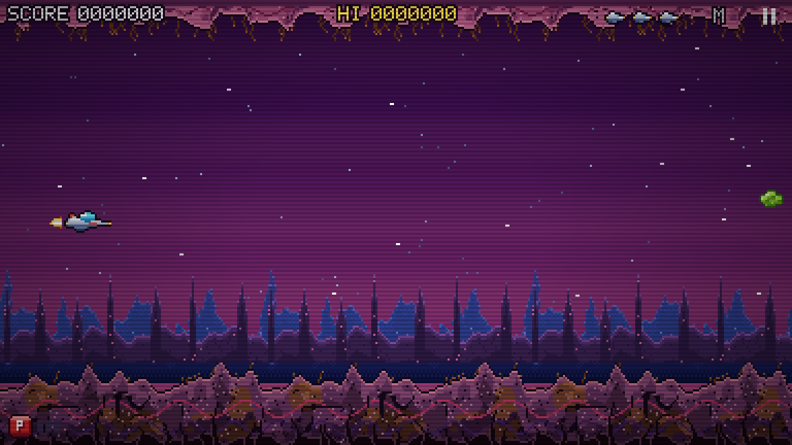
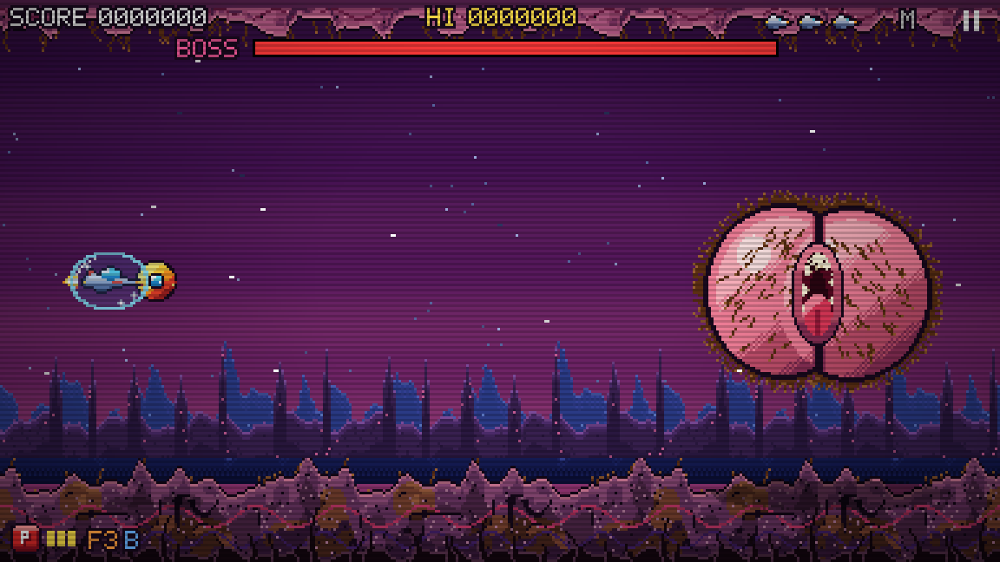

# aasssMaster

A vertical shoot-'em-up with a hairy-butt alien theme, played in the browser. Every sprite is drawn in code and every
sound is synthesised in the browser. There are no image, audio or font files.


## Quick start

Serve the folder over HTTP, then open the game:

```bash
python3 -m http.server 8000
```

Game: <http://localhost:8000/>

## The game

Stages 1 to 3 each end in a boss, and stages 2 and 3 have a mid-boss part way through. After stage 3 the run loops with
higher boss HP and loop modifiers.

| Stage | Name | Length | Boss |
|-------|------|--------|------|
| 1 | HAIRY NEBULA | 60 s | `boss_butt` |
| 2 | THE CRACK OF DOOM | 70 s | `boss_crack` (mid-boss at 40 s) |
| 3 | RECTUM OF THE GODS | 80 s | `boss_god` (mid-boss at 45 s) |





### Controls

| Action | Keyboard | Touch |
|--------|----------|-------|
| Move | Arrows or WASD | Drag on the left side. The ship follows the finger, not an absolute position. |
| Fire | Z, Space or Ctrl (hold) | Hold on the right side |
| Charged beam | Hold X | Hold longer on the right side |
| Force pod | C or Shift (toggle) | Tap on the left side to throw the Force |
| Bomb | B | |
| Pause | P or Esc | |
| Mute | M | |
| Haptics | V | |

### Components

| File | What it does |
|------|--------------|
| `index.html` | The page shell. Loads the scripts in order and sizes the canvas. |
| `js/sprites.js` | Global `Sprites`. Builds every sprite from character grids at load, plus a small pixel font. |
| `js/sfx.js` | Global `SFX`. Synthesises sound effects and the chiptune tracks for the title, the stages, mid-bosses, bosses and game over. |
| `js/levels.js` | Global `Levels`. Pure data: ten regular enemy types, one mid-boss and three bosses, wave scripts, boss phases, loop modifiers, power-up drops, and `validate()`. |
| `js/render.js` | Global `GameRender`. Everything drawn to the canvas: backdrop, raster effects, HUD, banners and the title, continue and game-over screens. |
| `js/game.js` | Global `Game`. The engine: the loop, input, collision, weapons, the Force pod, bosses, scoring, checkpoints and the debug hooks. |

Debug hooks on `Game` (`info()`, `skipTo(stage, t)`, `skipToBoss()`, `give(power, force, shield)`, `step(n)`) make it
possible to reach any point in a run from the console.

## Repo layout

```
index.html, js/      the game
team/                the four-role design discussion behind the v2 rewrite
CONTRACT.md          the module contract between the game's files
docs/screenshots/    screenshots used in this README
prd.md               product requirements
future.md            open items and ideas
CLAUDE.md            guidance for coding agents working in this repo
```

## Everything is generated

There are no image, audio or font files in this project. All the pixel art is built in code, all the sounds and music
are synthesised in the browser, and the levels are plain data. Clone it, change a number in `js/levels.js` and reload.
`Levels.validate()` logs a warning to the console when a change breaks a stage.
